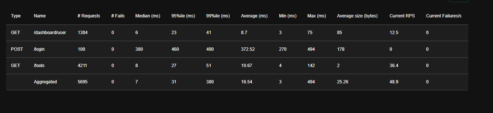
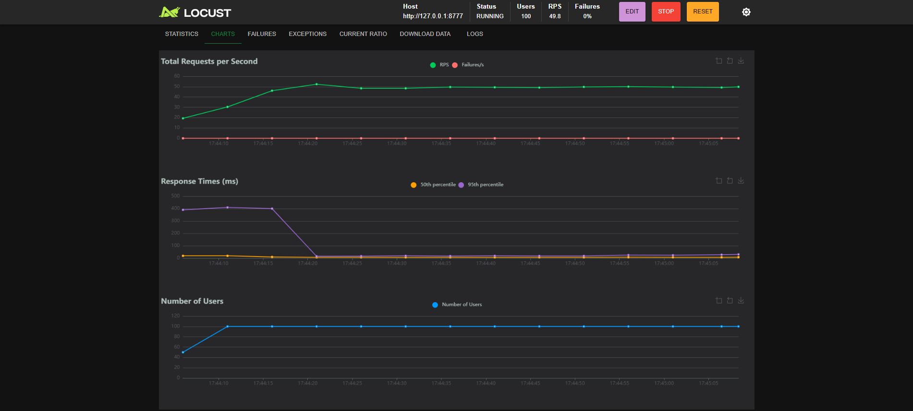

# Звіт з навантажувального тестування (Лабораторна робота №4)

**1. Профіль навантаження:**
- Інструмент: Locust
- Цільові ендпоінти: `POST /login`, `GET /tools`, `GET /dashboard/user`
- Кількість віртуальних користувачів (VUsers): 100[cite: 2]
- Час розгону (Spawn rate): 10 користувачів/сек
- Тривалість тесту: ~2-3 хвилини

**2. Отримані метрики:**

| Метрика | Значення                                 |
|---|------------------------------------------|
| RPS (запити за секунду) | ~ 48.9[cite: 3]                          |
| Latency (Середній час) | 16.54 мс[cite: 3]                        |
| Latency (Min / Max) | 3 мс / 494 мс[cite: 3]                   |
| Latency (95-й перцентиль) | 31 мс[cite: 3]                           |
| Error Rate (Відсоток помилок) | 0% (0 з 5695 запитів)[cite: 2, 3]        |
| Ресурси сервера | CPU: ~25% (у піку до ~80%), RAM: ~12.2 ГБ (загальне ОС) |

**3. Графіки:**

**4. Висновки та "вузькі місця":**
Тестування показало, що при навантаженні у 100 одночасних користувачів система працює надзвичайно стабільно та швидко[cite: 2]. Жоден запит не завершився помилкою (Error Rate = 0%)[cite: 2]. 
Середній час відповіді системи склав всього 16.54 мс[cite: 3], що є відмінним показником. Найбільша затримка (Max 494 мс) спостерігалася виключно під час операції `POST /login`[cite: 3]. Це зумовлено використанням алгоритму хешування bcrypt, який навмисно споживає ресурси CPU для забезпечення криптографічної стійкості паролів. Ендпоінти `GET` відпрацьовують миттєво (в середньому 8-10 мс)[cite: 3].

Головним потенційним "вузьким місцем" на даному етапі залишається використання файлової бази даних SQLite. Оскільки SQLite блокує весь файл під час запису, при додаванні інтенсивних операцій POST/PUT/DELETE база даних може стати фактором різкого збільшення Latency. Для подальшого масштабування рекомендується перехід на PostgreSQL.