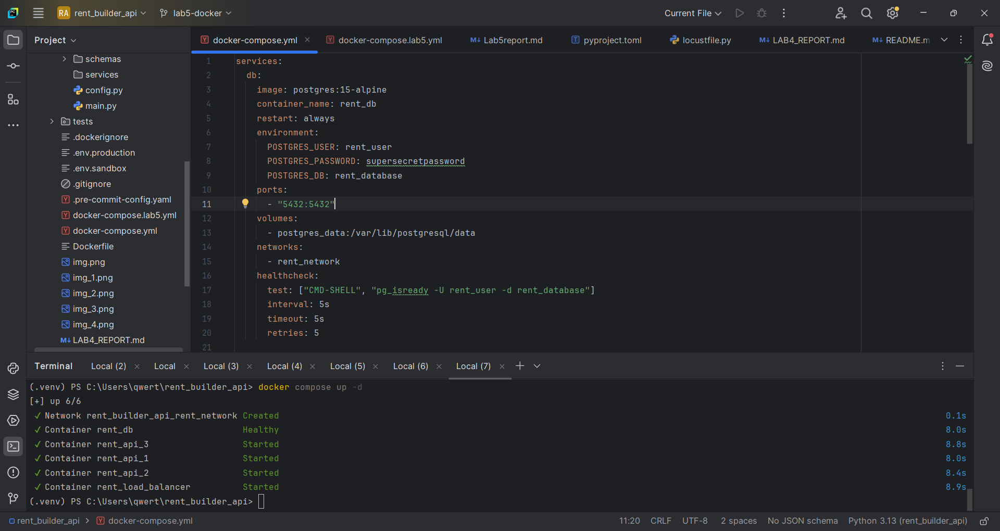
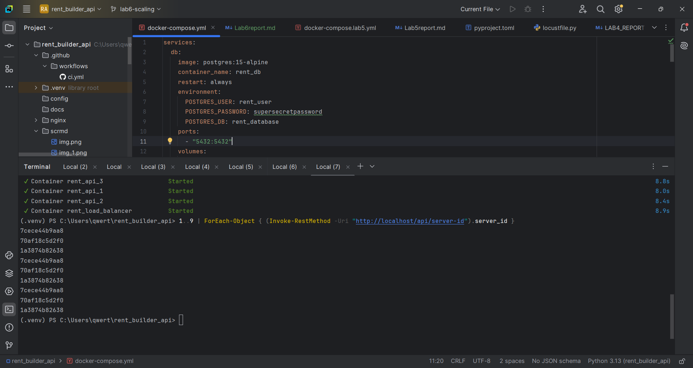
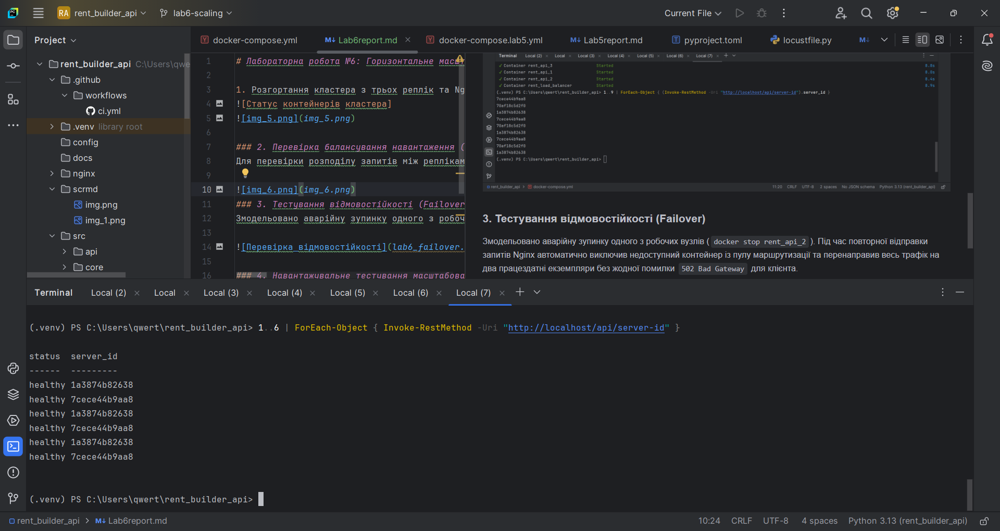
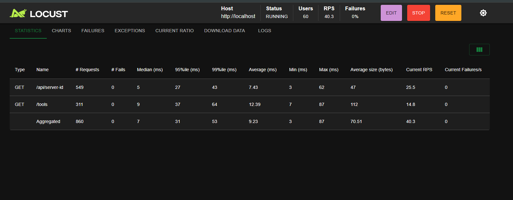
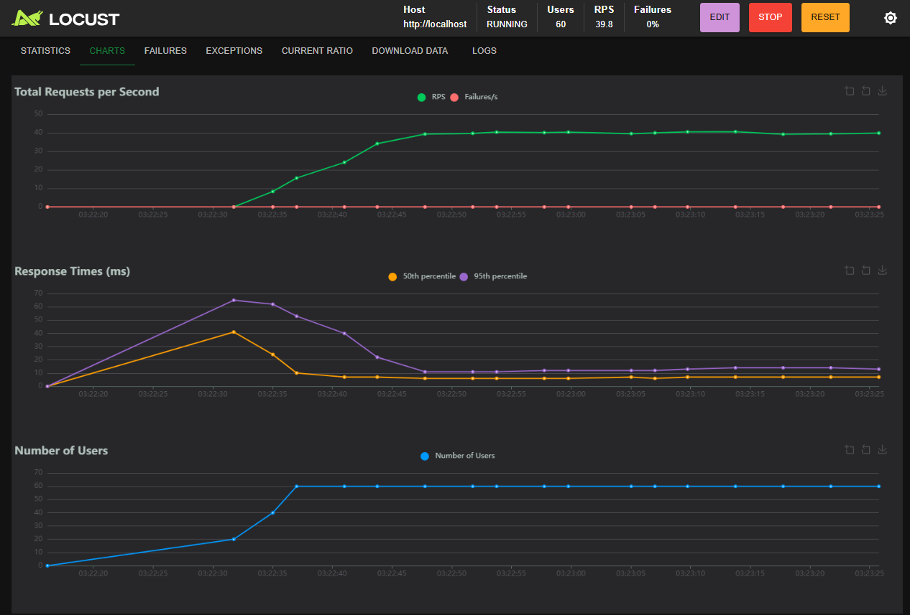

# Лабораторна робота №6: Горизонтальне масштабування, балансування навантаження (Nginx) та відмовостійкість

1. Розгортання кластера з трьох реплік та Nginx
![Статус контейнерів кластера]

### 2. Перевірка балансування навантаження (Round Robin)
Для перевірки розподілу запитів між репліками виконано серію HTTP-запитів до ендпоінта `/api/server-id`. Балансувальник Nginx рівномірно та почергово розподіляє вхідні запити між усіма трьома активними контейнерами.

### 3. Тестування відмовостійкості (Failover)
Змодельовано аварійну зупинку одного з робочих вузлів (`docker stop rent_api_2`). Під час повторної відправки запитів Nginx автоматично виключив недоступний контейнер із пулу маршрутизації та перенаправив весь трафік на два працездатні екземпляри без жодної помилки `502 Bad Gateway` для клієнта.

### 4. Навантажувальне тестування масштабованої системи (Locust)
Проведено тестування кластера під навантаженням 60 одночасних користувачів. Система стабільно обробила потік запитів із нульовим відсотком відмов (`0% Failures`) та мінімальними затримками на ендпоінтах читання даних.

