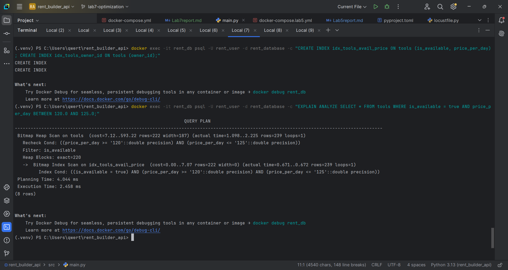
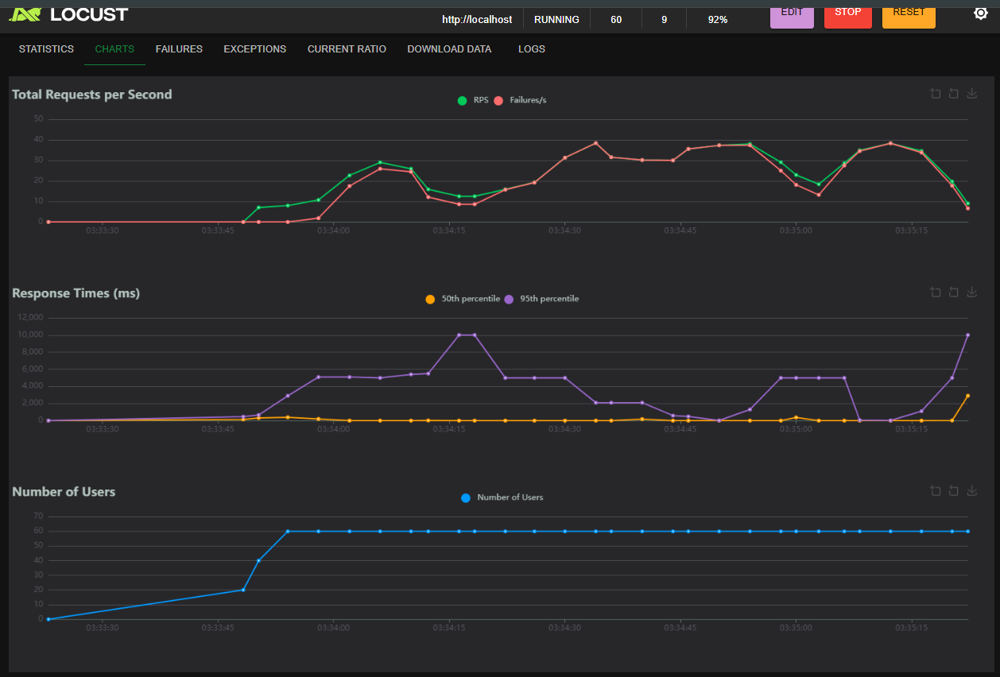
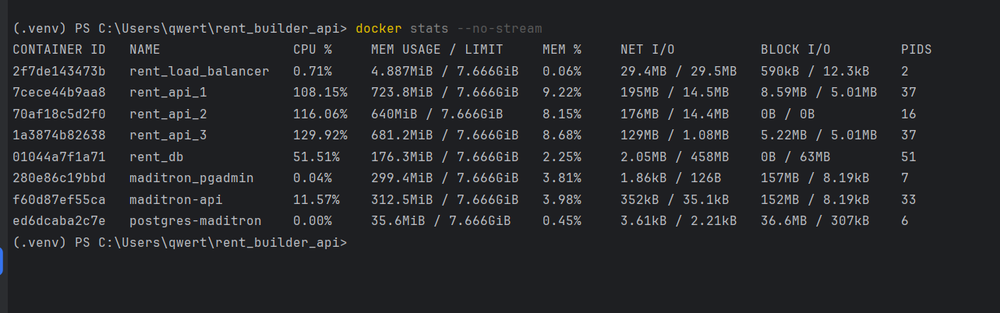
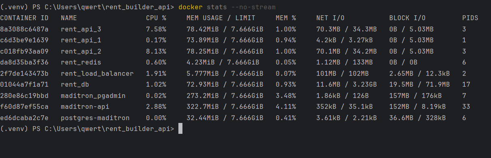
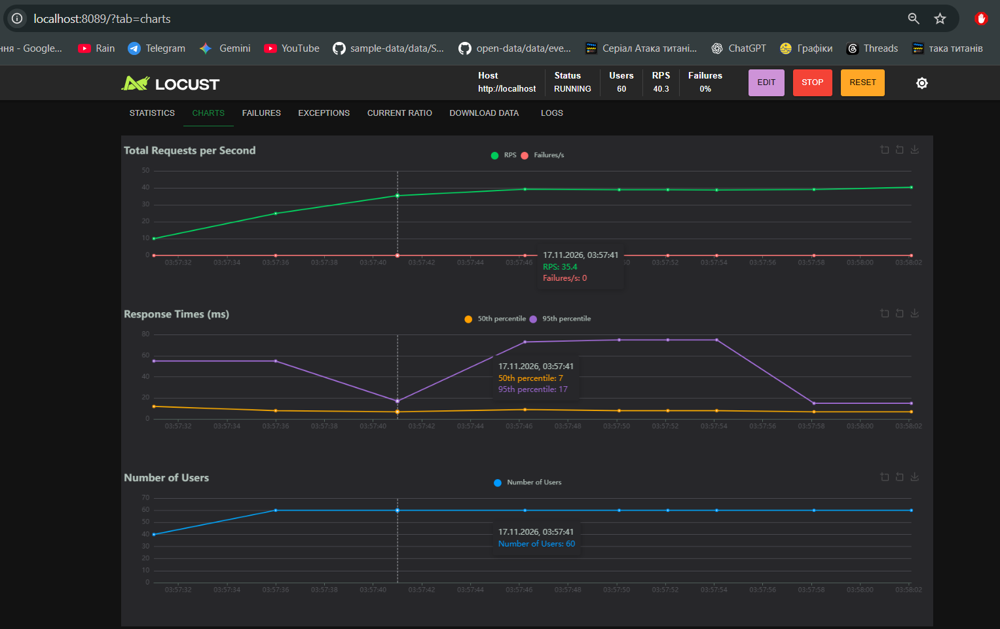

# Лабораторна робота №7: Оптимізація продуктивності веб-системи

## 1. Вузькі місця та оптимізація (50 000 записів у `tools`)

**Виявлені проблеми:**
1. **Вибірка без лімітів:** `GET /tools` повертав усі 50 000 записів за один запит, навантажуючи CPU до 129% та RAM до 724 МБ на репліку.
2. **Повне сканування таблиці (`Seq Scan`):** Повільна фільтрація за ціною та наявністю через відсутність індексів.
3. **Зайве навантаження на БД:** Постійні однотипні запити до PostgreSQL (458 МБ трафіку).

**Що зроблено:**
- **Пагінація:** Додано параметри `skip` та `limit=50` для `GET /tools`.
- **Індексування БД:** Створено складений B-Tree індекс `idx_tools_avail_price` на `(is_available, price_per_day)` та індекс `idx_tools_owner_id`.
- **Кешування в Redis:** Підключено `redis:7-alpine` із **TTL = 60 секунд** для `GET /tools` та автоочищенням кешу при `POST /tools`.

## 2. Аналіз SQL-запитів (`EXPLAIN ANALYZE`)

Запит: `EXPLAIN ANALYZE SELECT * FROM tools WHERE is_available = true AND price_per_day BETWEEN 120.0 AND 125.0;`

Після додавання індексу PostgreSQL використовує **`Bitmap Index Scan`**, а час виконання скоротився до **2.458 мс**.

## 3. Навантажувальне тестування (Locust: 60 users, 10 spawn rate)

### ДО оптимізації
Затримки сягали **10 000 мс**, а **94%** запитів падали з помилкою через перевантаження контейнерів.

### ПІСЛЯ оптимізації
Система стабільно тримає **40.3 RPS** при **0% помилок**, медіана — **7 мс**, 95-й перцентиль — **17 мс**.

## 4. Порівняння результатів

| Метрика | ДО | ПІСЛЯ | Покращення |
| :--- | :---: | :---: | :--- |
| **RPS** | 9.1 | **40.3** | Зростання у 4.4 раза |
| **Медіана (50%ile)** | ~500–3000 мс | **7 мс** | Зниження у >70 разів |
| **95-й перцентиль** | 10 000 мс | **17 мс** | Зниження у 588 разів |
| **Помилки (Failures)** | 94% | **0%** | Усунено повністю |
| **CPU (API репліки)** | 108% – 129% | **~5% – 15%** | Менше у ~10 разів |
| **RAM (на репліку)** | 640 – 724 МБ | **~55 – 80 МБ** | Менше у ~9 разів |
| **SQL-пошук (`EXPLAIN`)** | Seq Scan (~20+ мс) | **Index Scan (2.45 мс)** | Прискорення вибірки |

## Висновки
Пагінація та кешування в Redis (TTL 60 с) зняли основне навантаження з CPU, пам'яті та бази даних, скоротивши затримки з 10 секунд до 7–17 мс при 0% відмов. Складений індекс у PostgreSQL прискорив фільтрацію записів до 2.45 мс під час першого звернення до БД.