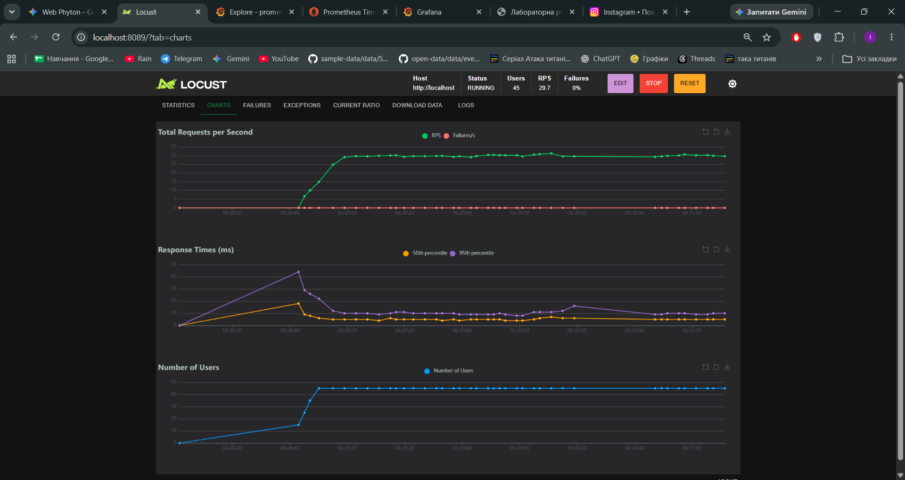
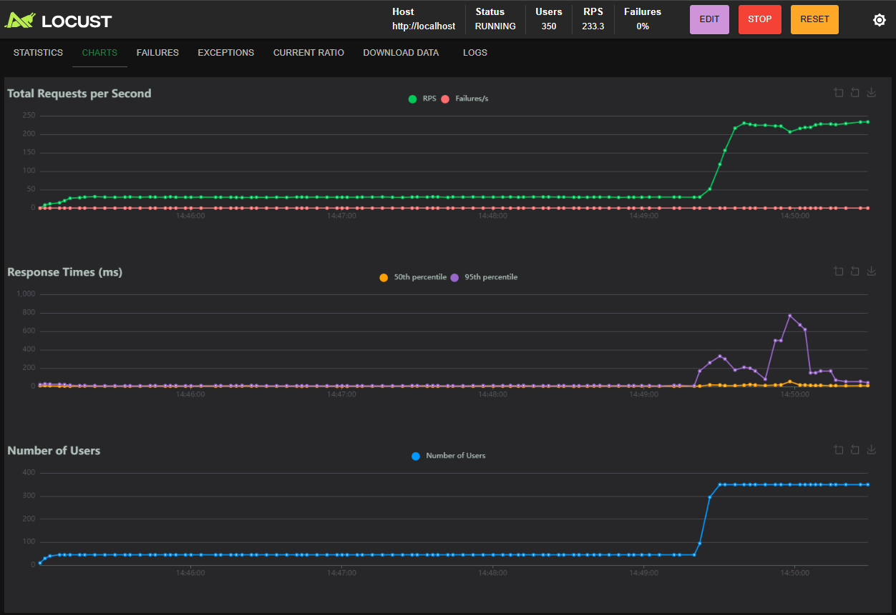
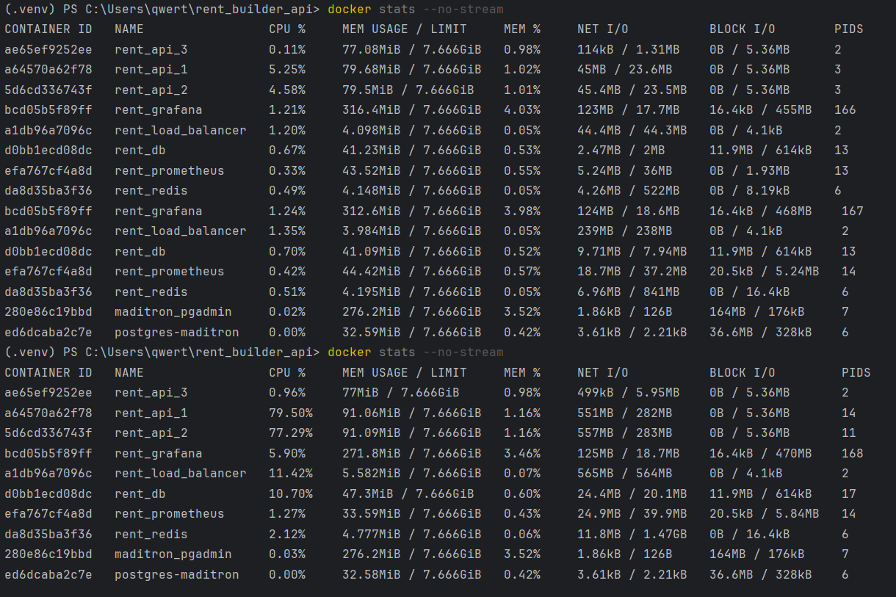
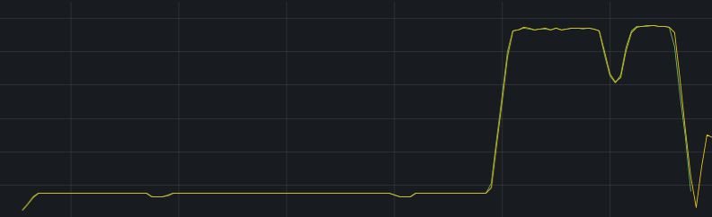

# Звіт з лабораторної роботи №8

Інфраструктура системи розгорнута у середовищі Docker Compose та складається з 8 контейнерів, об'єднаних у віртуальну мережу:

- **rent_load_balancer (Nginx, порт 80)** — вхідний балансувальник навантаження (Reverse Proxy), який розподіляє HTTP-трафік між репліками застосунку за алгоритмом Round-Robin[cite: 5].
- **rent_api_1, rent_api_2, rent_api_3 (FastAPI + Uvicorn, внутрішній порт 8000)** — три горизонтальні репліки бекенд-сервісу з підключеним інструментатором prometheus-fastapi-instrumentator, що експортує телеметрію на ендпоінт /metrics[cite: 1, 5].
- **rent_db (PostgreSQL 15 Alpine, порт 5432)** — реляційна база даних із B-Tree індексами на полях фільтрації[cite: 5].
- **rent_redis (Redis 7 Alpine, порт 6379)** — in-memory кеш-сервер для реалізації патерну Cache-Aside (TTL = 60 с) на маршруті GET /tools[cite: 5, 7].
- **rent_prometheus (Prometheus, порт 9090)** — сервер збору часових рядів (Time-Series Database), який кожні 5 секунд опитує (scrape) ендпоінти /metrics кожної репліки API[cite: 1, 5].
- **rent_grafana (Grafana, порт 3000)** — платформа візуалізації метрик та побудови дашбордів у реальному часі[cite: 2, 5].

**Фрагмент інтеграції метрик у файл src/main.py:**

    from prometheus_fastapi_instrumentator import Instrumentator

    app = FastAPI(debug=settings.DEBUG)
    Instrumentator().instrument(app).expose(app, endpoint="/metrics")

**Конфігурація файлу prometheus.yml:**

    global:
      scrape_interval: 5s

    scrape_configs:
      - job_name: "rent_api_cluster"
        metrics_path: "/metrics"
        static_configs:
          - targets: ["api1:8000", "api2:8000", "api3:8000"]

**Запит PromQL у Grafana для візуалізації розподілу RPS між репліками:**

    sum(rate(http_requests_total[1m])) by (instance)

##  Результати тестування на витривалість (Soak Testing)

**Параметри тесту:**

- **Кількість одночасних користувачів (Users):** 45 (~75% від розрахункового робочого навантаження)[cite: 6, 7]
- **Швидкість підключення (Spawn rate):** 5 users/s
- **Тестові маршрути:** GET /api/server-id та GET /tools[cite: 7]

**Зафіксовані показники Locust під час Soak-тесту[cite: 6, 7]:**

| Маршрут | Запитів | Помилки | Median (ms) | 95%ile (ms) | Current RPS |
| :--- | :---: | :---: | :---: | :---: | :---: |
| GET /api/server-id | 4085 | 0 (0%) | 4 | 7 | 18.2 |
| GET /tools | 2527 | 0 (0%) | 8 | 13 | 11.5 |
| Aggregated | 6612 | 0 (0%) | 5 | 11 | 29.7 |

Додаткові показники із таблиці статистики Soak-тесту[cite: 6, 7]:

- **99-й перцентиль (99%ile):** 11 мс для GET /api/server-id, 20 мс для GET /tools та 17 мс сумарно (Aggregated)[cite: 7].
- **Середній час відповіді (Average):** 4.62 мс для GET /api/server-id, 8.96 мс для GET /tools та 6.28 мс сумарно[cite: 7].
- **Мінімальний та максимальний час відповіді (Min / Max):** 3 мс / 83 мс для GET /api/server-id та 6 мс / 84 мс для GET /tools[cite: 7].
- **Пропускна здатність на графіку (Total RPS):** стабільне плато 29.7–29.9 RPS за повної відсутності помилок (0% Failures)[cite: 6, 7].

**Аналіз результатів Soak Testing:**

- Протягом усього періоду тестування система утримувала ідеально рівне плато пропускної здатності на рівні 29.7–29.9 RPS без жодної помилки (0% Failures)[cite: 6, 7].
- Час відповіді залишався стабільним і не зазнав деградації з часом: медіанна затримка (50th percentile) трималася на рівні 5 мс, а 95-й перцентиль не перевищував 11 мс[cite: 6, 7].

##  Аналіз споживання апаратних ресурсів (docker stats) та перевірка витоків пам'яті

Для перевірки відсутності витоків оперативної пам'яті (Memory Leaks) та контролю навантаження на процесор під час тривалого тестування було виконано послідовні зрізи стану контейнерів командою docker stats --no-stream[cite: 5]:

| Контейнер | CPU % (Зріз 1 -> 2) | RAM (Зріз 1 -> 2) | Частка RAM | NET I/O (Зріз 2) |
| :--- | :---: | :---: | :---: | :---: |
| rent_api_1 | 5.25% -> 6.38% | 79.68 -> 81.36 MiB | 1.04% | 221 MB / 118 MB |
| rent_api_2 | 4.58% -> 5.80% | 79.50 -> 81.38 MiB | 1.04% | 222 MB / 118 MB |
| rent_api_3 | 0.11% -> 0.12% | 77.08 -> 76.95 MiB | 0.98% | 382 kB / 4.53 MB |
| rent_load_balancer | 1.20% -> 1.35% | 4.098 -> 3.984 MiB | 0.05% | 239 MB / 238 MB |
| rent_db | 0.67% -> 0.70% | 41.23 -> 41.09 MiB | 0.52% | 9.71 MB / 7.94 MB |
| rent_redis | 0.49% -> 0.51% | 4.148 -> 4.195 MiB | 0.05% | 6.96 MB / 841 MB |
| rent_prometheus | 0.33% -> 0.42% | 43.52 -> 44.42 MiB | 0.57% | 18.7 MB / 37.2 MB |
| rent_grafana | 1.21% -> 1.24% | 316.4 -> 312.6 MiB | 3.98% | 124 MB / 18.6 MB |

**Висновки з апаратного моніторингу:**

- **Відсутність витоків пам'яті (Memory Leaks):** після проходження понад 220 МБ мережевого трафіку через репліки API обсяг зайнятої оперативної пам'яті стабілізувався в межах 76.95–81.38 MiB (~1.04% від доступних 7.666 GiB RAM) і не зростав лінійно з часом[cite: 5]. У контейнерах rent_db (~41.09 MiB) та rent_redis (~4.195 MiB) споживання пам'яті залишилося константним завдяки обмеженому пулу з'єднань SQLAlchemy та встановленому TTL = 60 с для ключів кешу[cite: 5].
- **Низька утилізація CPU:** сумарне навантаження на процесор на кожній активній репліці становило лише 5.25%–6.38% (при гранично допустимому порозі до 80%), а навантаженість СУБД PostgreSQL не перевищувала 0.70% CPU за рахунок того, що основний потік читання GET /tools обслуговувався безпосередньо з оперативної пам'яті Redis (видано 841 МБ кешованих відповідей)[cite: 5].

## 5. Результати стрес-тестування та пікових навантажень (Spike Testing)

Для перевірки поведінки кластера в умовах раптової лавини запитів кількість одночасних користувачів була різко збільшена з 45 до 350 (при Spawn rate = 50 users/s) без зупинки тесту[cite: 8, 9].

**Зафіксовані показники Locust під час Spike-тесту (350 користувачів)[cite: 8, 9]:**

| Маршрут | Запитів | Помилки | Median (ms) | 95%ile (ms) | Current RPS |
| :--- | :---: | :---: | :---: | :---: | :---: |
| GET /api/server-id | 7669 | 0 (0%) | 5 | 83 | 135.1 |
| GET /tools | 4852 | 0 (0%) | 9 | 210 | 89.4 |
| Aggregated | 12521 | 0 (0%) | 7 | 120 | 224.5 |

Додаткові показники із таблиці статистики та графіків Spike-тесту[cite: 8, 9]:

- **99-й перцентиль (99%ile):** 190 мс для GET /api/server-id, 370 мс для GET /tools та 310 мс сумарно (Aggregated)[cite: 8].
- **Середній час відповіді (Average):** 16.01 мс для GET /api/server-id, 36.44 мс для GET /tools та 23.93 мс сумарно[cite: 8].
- **Мінімальний та максимальний час відповіді (Min / Max):** 3 мс / 470 мс для GET /api/server-id та 6 мс / 711 мс для GET /tools[cite: 8].
- **Пікова пропускна здатність на графіку (Total RPS):** 224.5–233.3 RPS при 0% помилок[cite: 8, 9].

**Аналіз результатів Spike Testing та самовідновлення системи:**

- **Пропускна здатність на піку:** при 7.7-кратному збільшенні кількості користувачів (з 45 до 350) кластер масштабував пропускну здатність майже у 8 разів — з 29.9 RPS до 233.3 RPS, обробивши 12 521 запит без жодної помилки (0% Failures, відсутні помилки 502 Bad Gateway чи 500 Internal Server Error)[cite: 6, 8, 9].
- **Поведінка затримок (Latency) та самовідновлення:** у момент різкого спаун-стрибка 350 користувачів (о 14:50:00) спостерігався короткочасний пік 95-го перцентиля затримки до ~760 мс (максимум 711 мс у таблиці агрегації) через одночасне створення нових TCP-з'єднань[cite: 8, 9]. Проте вже через 15–20 секунд роботи під навантаженням 350 користувачів графік 95-го перцентиля самостійно стабілізувався та опустився нижче 50–120 мс, а медіана залишилася на рівні 7 мс (5 мс для /api/server-id та 9 мс для /tools)[cite: 8, 9].

## 6. Висновки

- Інтегровано стек моніторингу Prometheus + Grafana у мікросервісну архітектуру FastAPI: метрики збираються у реальному часі з частотою 5 секунд через ендпоінт /metrics та дозволяють контролювати RPS і стан кожної репліки за допомогою PromQL-запиту sum(rate(http_requests_total[1m])) by (instance)[cite: 1, 2, 3].
- Проведене Soak-тестування підтвердило високу стабільність оптимізованої архітектури при тривалому навантаженні: система забезпечує стабільну медіанну затримку 5 мс при утилізації процесора лише ~6% та споживанні пам'яті ~81 MiB на репліку без жодних ознак витоків пам'яті чи вичерпання пулу з'єднань БД[cite: 5, 6, 7].
- Проведене Spike-тестування (350 конкурентних користувачів) довело здатність кластера з балансувальником Nginx та кешем Redis витримувати раптові 8-кратні сплески трафіку (до 233.3 RPS) із 0% відмов та автоматично стабілізувати час відповіді без необхідності ручного перезапуску контейнерів[cite: 8, 9].

x